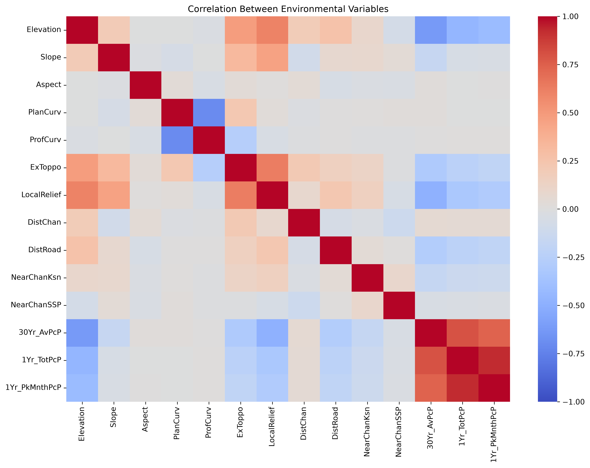
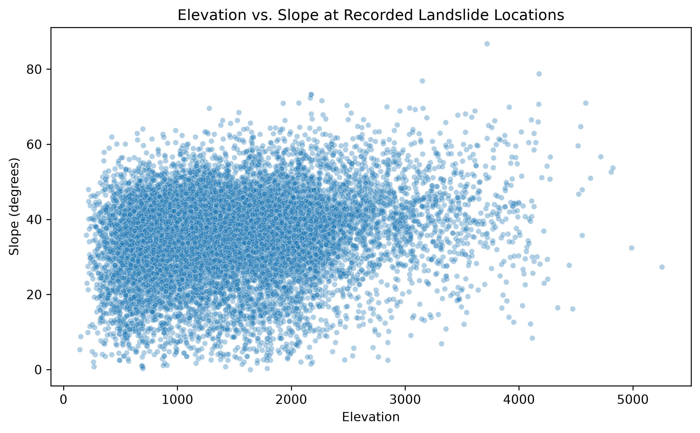
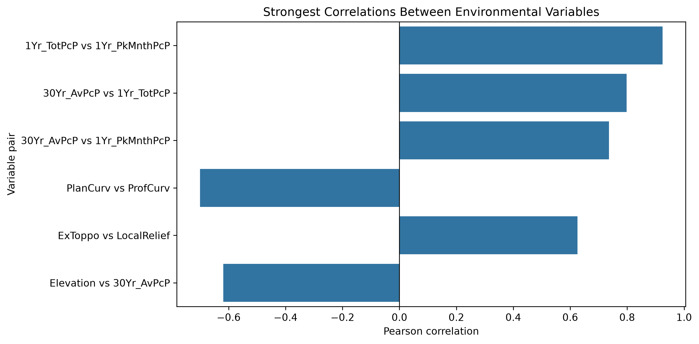

# Nepal Landslide Data Analysis

## About the Project

Nepal experiences landslides in different parts of the country, particularly during the monsoon season. Rainfall, steep slopes, and the surrounding landscape can all be relevant when studying where landslides occur.

I chose this project to explore the environmental characteristics of recorded landslide locations in Nepal and see what patterns can be found in the available data. I am using Python to clean the dataset, explore the variables, and understand how some of these characteristics relate to one another.

My main research question is:

**What environmental characteristics are associated with recorded landslide locations in Nepal, and what can the available data tell us about landslide susceptibility?**

## Dataset

For this project, I am using the *Attribute Point Inventory of 12,838 Asia Summer Monsoon (ASM)-Triggered Landslides in Nepal* dataset, published through the UK government's data service.

The dataset contains 12,838 recorded landslide locations from the period 1988–2018. The original file has 32 columns, including information about terrain, precipitation, land use, geology, and tectonic units.

Dataset link: [Attribute Point Inventory of Landslides in Nepal](https://ckan.publishing.service.gov.uk/dataset/attribute-point-inventory-of-12838-asia-summer-monsoon-asm-triggered-landslides-in-nepal-nerc-g)

For the initial analysis, I selected 17 environmental variables that were relevant to my research question.

## What I Have Done So Far

I started by loading the dataset into Python and looking at its structure, columns, and summary statistics. I then selected the environmental variables I wanted to focus on and checked for missing values and possible data-quality issues.

Some values were missing, so I used the median to fill missing numerical values and labeled missing categorical values as `Unknown`. I also found one aspect value of -1, which falls outside the expected compass-direction range. I treated it as missing and replaced it using the median. These changes were made to a separate prepared dataset so that the original data remained unchanged.

After preparing the data, I checked for remaining missing values, duplicate rows, and basic issues with slope and aspect values. I then explored the distributions of several variables and created visualizations to better understand the data.

I also calculated correlations between the numerical environmental variables to identify which ones had stronger relationships.

## What I Found

One of the strongest relationships was between annual total precipitation and peak-month precipitation, with a correlation of **0.924**. Long-term average precipitation was also strongly correlated with annual total precipitation (**0.798**) and peak-month precipitation (**0.736**).

I found a strong negative correlation between plan curvature and profile curvature (**−0.701**). Elevation was negatively correlated with long-term average precipitation (**−0.619**) and positively correlated with local relief (**0.606**).

These results helped me see that some environmental variables are closely related to one another. For example, the precipitation variables may contain overlapping information, which is worth considering in any future modeling work.

However, these findings only describe the recorded landslide locations in the dataset. They do not prove that any particular environmental characteristic causes landslides or makes a location more susceptible to them.

## Limitations and Next Steps

One important limitation is that the dataset contains recorded landslide locations but does not include verified non-landslide locations for comparison in my current analysis. Because of this, I cannot yet reliably determine how the environmental characteristics of landslide locations differ from those of stable areas.

I also need to verify the definitions and units of the environmental variables against the original dataset documentation before making stronger interpretations.

My next steps are to review the analysis, make sure the notebook runs correctly from beginning to end, improve the project documentation, and identify what additional data would be needed for a more reliable landslide-susceptibility study.

## Visualizations

### 1. Correlation Heatmap

This heatmap shows the Pearson correlations between numerical environmental variables. Positive values indicate positive linear relationships, while negative values indicate negative linear relationships.



### 2. Elevation vs. Slope

This scatter plot explores the relationship between elevation and slope across the recorded landslide locations.



### 3. Strongest Correlations

This chart highlights six of the strongest correlations found between numerical environmental variables in the dataset.




## Project Structure

```text
nepal-landslide-ml/
├── data/
│   ├── raw/
│   └── processed_environmental_data.csv
├── notebooks/
│   └── 01_data_exploration.ipynb
├── figures/
├── src/
├── requirements.txt
└── README.md
```

## Tools Used

- Python
- pandas
- NumPy
- Matplotlib
- Seaborn
- Jupyter Notebook

## How to Run the Project

Clone or download the repository, create a Python virtual environment, and install the required packages listed in `requirements.txt`.

For Windows PowerShell:

```powershell
python -m venv .venv
.\.venv\Scripts\Activate.ps1
pip install -r requirements.txt
```

Then open `notebooks/01_data_exploration.ipynb` in VS Code or Jupyter Notebook and run the cells in order. The original dataset should be available in the expected `data/raw/` location.

## Current Status

I have completed the initial data exploration, prepared the environmental dataset, checked its basic quality, and explored correlations between numerical variables. I am now working on reviewing the analysis and preparing the project for submission.